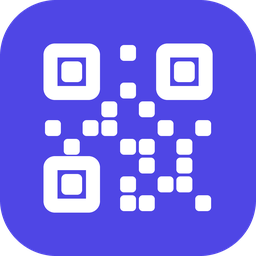

<p align="center"></p>

# 🔳 Kodo — QR Instant
[](https://opensource.org/licenses/MIT)

Read and create QR codes on your PC in a second. ⚡  
Press a shortcut, drag over a QR code anywhere on your screen, and see what's inside. Or turn your clipboard into a QR code, ready to scan with your phone.

Kodo lives in the notification area, uses almost no memory and works **offline**, on your PC.

---

## 🚀 Features

- 🔍 **Read a QR code** (`Ctrl + Shift + Q`): select an area of the screen and a small card shows what the code holds
  - 🔗 **Links**: open them in your browser or copy them
  - 📶 **Wi-Fi**: see the network name and password, copy either one
  - 📋 **Text**: copied straight to your clipboard
  - 📧 Emails, 📞 phone numbers, 💬 text messages, 👤 contacts (vCard / MeCard) and 📍 locations too
  - Several codes in the selection? Go through them with **Next code**
- ✨ **Create a QR code from the clipboard** (`Ctrl + Shift + G`): copy any text or link, press the shortcut and the code is there
  - 🖼️ **Copy image** to paste it into a chat or a document, or 💾 **Save PNG**
- 🧩 **Templates**: create codes for a 📶 **Wi-Fi network**, a 👤 **contact** (vCard) or an 📧 **email**, with a live preview
- 🕘 **History**: the codes you read and create, to show them again or copy their text. Stays on your PC, and you can turn it off
- 🖱️ Left-click the tray icon to read a code; right-click for the menu
- 🔒 100% offline: screenshots and codes never leave your PC. No telemetry, no accounts
- 🌍 Accents, emoji and any alphabet (日本語, Русский…) both when reading and creating
- 🌗 Reads dark-mode codes (light on dark), rotated and tiny on-screen codes
- 🖥️ Multiple monitors, mixed DPI scaling and monitors placed left of or above the main one
- 🌙 Clean Windows 11 look that follows your light or dark theme and accent color
- 🪶 Tiny: ~0.6 MB of memory and 0% CPU while idle, a ~2.6 MB installer, no .NET or Visual C++ runtime needed
- 🚦 Starts with Windows (you can turn it off)

---

## 📦 Install

Download `KodoSetup.exe` from [Releases](https://github.com/VitomDev/Kodo-QR-Instant/releases/latest) and run it.

- Per-user install, no admin rights needed
- Kodo starts right away and its icon appears in the notification area
- It starts with Windows from then on

Uninstalling (Settings → Apps) removes Kodo, its startup entry, its settings and its history.

---

## 🖱️ Usage

| Action | How |
| --- | --- |
| Read a QR code | `Ctrl + Shift + Q`, or left-click the tray icon, then drag over the code |
| Create a QR from the clipboard | `Ctrl + Shift + G`, or right-click the tray icon → **Create QR from clipboard** |
| Wi-Fi, contact or email code | Right-click the tray icon → **Create QR code…** and pick a template |
| History | Right-click the tray icon → **History** |
| Cancel a selection | `Esc` or right-click |
| Settings | Right-click the tray icon → **Settings** |
| Exit | Right-click the tray icon → **Exit Kodo** |

After reading, the card closes with `Esc`, the ✕ button or by clicking elsewhere. `Enter` runs the main action (e.g. **Open link**). If there's no QR code in the selection, Kodo tells you with a small *No QR code found* note.

🛡️ For your safety, Kodo only opens `http` and `https` links. Anything else (files, programs, other schemes) is shown as text, never run.

### ⚙️ Settings

- **Shortcuts** for reading and creating
- **History**: keep it or not, and clear it
- **Start with Windows**

---

## 🎯 What it reads

All QR code variants: **QR Code**, **Micro QR** and **rMQR**, as they appear on screen: in web pages, PDFs, images, videos or a video call.

Tip: select the code with a little space around it. Very small codes (2 pixels per module) are read too, but zooming in helps if a code is blurry.

Codes Kodo creates use the standard error correction level M (15%) and fit up to ~2,300 characters of plain text (fewer with accents or other alphabets). They are created at 1024 px for **Save PNG** and ~600 px for **Copy image**, so they stay sharp when printed.

---

## ⚡ Performance

Measured on the development PC (Windows 11):

| | |
| --- | --- |
| Idle CPU (60 s) | 0 ms |
| Idle memory | 0.6 MB working set, 2.1 MB private |
| Idle threads | 1 |
| `Kodo.exe` / installer | 1.3 MB / 2.6 MB |

---

## 🔧 Build

Requirements: Visual Studio 2022 or newer with the C++ x64 tools and Inno Setup 6 (`winget install JRSoftware.InnoSetup`).

```powershell
.\build.ps1
```

It downloads the pinned dependencies into `.deps/` (Windows SDK, CMake, Ninja and ZXing-C++, all verified by hash), builds everything, runs the tests and writes the installer to `dist/KodoSetup.exe`.

`.\build.ps1 -SkipTests` and `.\build.ps1 -SkipInstaller` skip those steps.

---

## 📚 Dependencies

- [ZXing-C++](https://github.com/zxing-cpp/zxing-cpp) — reading and creating QR codes
- [Windows Imaging Component](https://learn.microsoft.com/windows/win32/wic/-wic-about-windows-imaging-codec) — PNG images, built into Windows

See [third-party notices](THIRD-PARTY-NOTICES.md) for licenses.

---

## 🪟 Compatibility

Windows 10 (version 1809 or newer) and Windows 11, 64-bit.

---

## 🧪 Project Status

✅ Stable.  
This project is fully functional as-is and ready to use.
Future updates to improve features or the interface are not ruled out.

---

## 📄 License

[MIT](LICENSE) © VitomDev

---

## 📲 Contact

Feel free to reach out or follow me:

- 🐙 GitHub: [@VitomDev](https://github.com/VitomDev)
- 🐦 Twitter/X: [@VitomDev](https://twitter.com/VitomDev)
- 🎮 Twitch: [@VitomDev](https://www.twitch.tv/VitomDev)
- 💼 LinkedIn: [Víctor Escós](https://www.linkedin.com/in/víctor-escós-batalla/)
